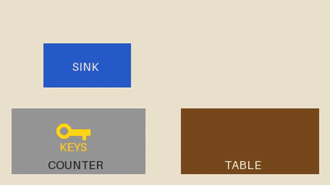
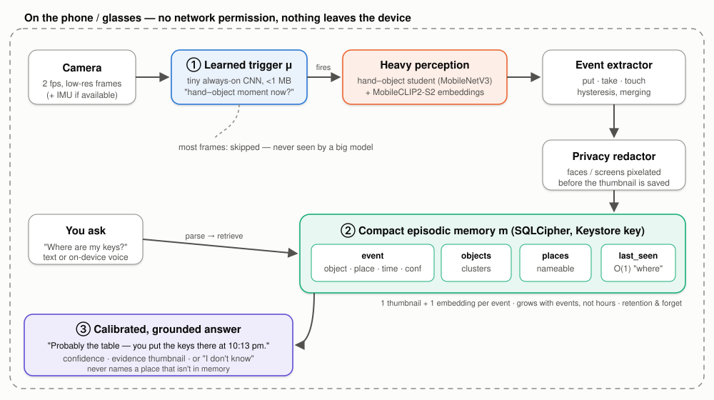
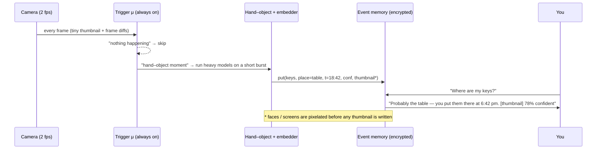
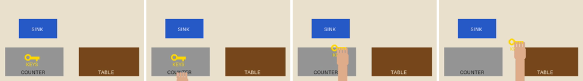
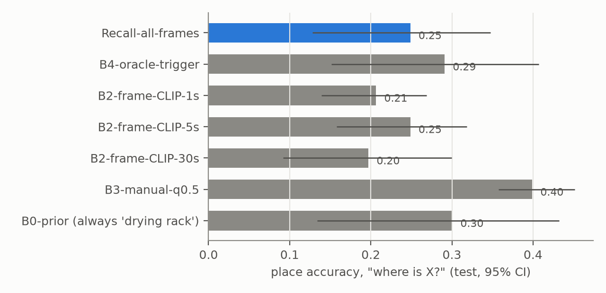
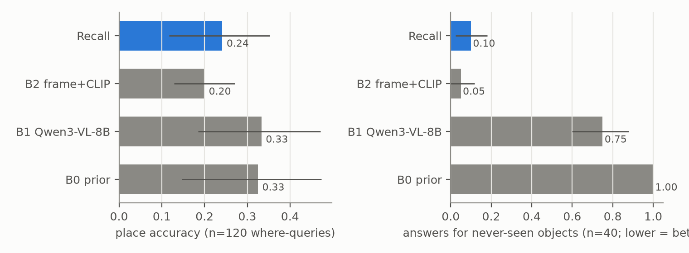
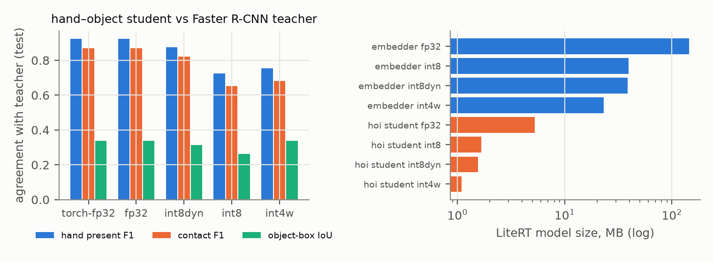
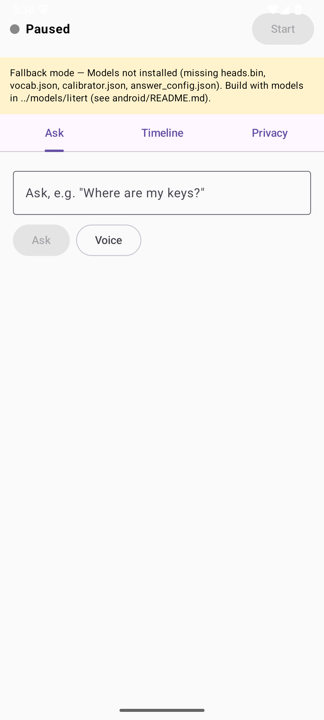
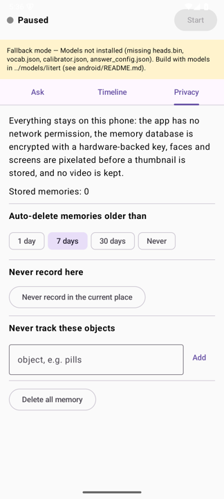
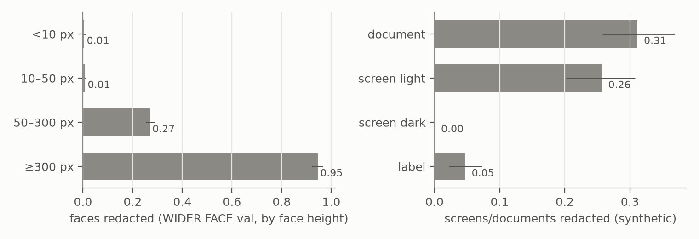

<div align="center">

# Recall

**An on-device visual memory that answers _"Where did I leave my keys?"_ from what the camera already saw —
without sending video anywhere.**

[](https://github.com/eshaan2418/Recall/actions/workflows/ci.yml)


<br>
<sub>The committed end-to-end test clip (synthetic, drawn — no real footage). The app watches it, then is asked where the keys are.</sub>

</div>

---

## Contents
[The idea](#the-idea) · [How it works](#how-it-works) · [Results](#results-so-far) · [The app](#the-android-app) ·
[Privacy](#privacy) · [Reproduce](#reproduce) · [Repo map](#repo-map) · [Limitations](#limitations--honest-caveats)

## The idea

People lose keys, forget whether they turned the stove off, and can't remember where they parked. A camera you
already wear (phone on a chest mount, or glasses) *saw* all of it. The obvious designs are bad:

| Design | Problem |
|---|---|
| Record video, ask a big cloud model later | Your whole day leaves the device; gigabytes per day; slow; confidently invents answers |
| Keep a frame every *N* seconds, search with CLIP | Misses the moment you put the keys down; returns a frame, not an answer |
| Tag things by hand | Nobody does it consistently |

**Recall** asks a narrower research question:

> Can a phone- or glasses-class device keep a full-day, queryable episodic memory under a ~5 %/hour battery budget and
> &lt;1 GB/week of storage, while answering object-location questions better than (a) a large vision-language model given
> sampled video and (b) frame sampling + CLIP retrieval?

It is built around three ideas:

1. **Learned memory triggering (μ)** — a tiny always-on network decides *when* something worth remembering happens
   (a hand puts down, picks up, opens, turns). Most frames never reach a large model.
2. **Compact episodic event memory (m)** — store *events* (`object, action, place, time, confidence, 1 thumbnail, 1 embedding`)
   in a small object–place–time graph instead of video, so storage grows with events, not hours.
3. **Calibrated, evidence-grounded answers** — every answer carries a confidence and the frame that supports it, and the
   system says *"I don't know"* instead of making something up.

## How it works

<p align="center"></p>



<p align="center"><br>
<sub>What the event extractor turns into memory: <code>take(keys, counter)</code> → <code>put(keys, table)</code>. Two rows instead of a video.</sub></p>

| Stage | Model (on device) | Where in the repo |
|---|---|---|
| Trigger μ | tiny causal CNN over 36×64 thumbnails + frame differences (+ IMU when present), &lt;1 MB | `recall/trigger/gate.py` |
| Hand–object | MobileNetV3-Small student distilled from the Shan et al. (CVPR 2020) Faster R-CNN teacher | `recall/compress/hoi_student.py` |
| Embeddings | MobileCLIP2-S2 image tower (picked on train/val only; ViT-L-14 kept as teacher reference) | `recall/perception/embed.py` |
| Events | put / take / touch with hysteresis and duplicate merging | `recall/perception/events.py` |
| Memory | SQLite (SQLCipher on Android) tables `events`, `objects`, `places`, `last_seen`; retention + forget | `recall/memory/store.py` |
| Answers | parse → retrieve → isotonic-calibrated confidence → templated, verified text (an LLM rephrase is accepted only if it adds no place) | `recall/qa/` |
| Export | LiteRT fp32 / INT8 (dynamic & static) / INT4-weight | `recall/compress/export.py` |

## Results so far

All numbers below are produced by scripts in this repo and stored in `results/` with git commit, hardware, model
versions, seed, config and timestamp; `make check-numbers` fails if this README quotes a number that isn't there.
Evidence stage is labelled for every systems number.

**Data.** No Ego4D access (see [BLOCKERS.md](BLOCKERS.md)), so evaluation uses **EPIC-KITCHENS-100**: participant-disjoint
splits of 27 / 10 / 21 videos (train / val / test). Ground truth comes from the participants' own narrations
("put X in Y", "take X", "turn off X"). The test set has 507 "where is X?" questions, 243 temporal, 163 on/off-state and
63 questions about objects that were **never** in the video (the right answer is "I don't know").

### 1 · Where is X? (M1, `offline-eval`)

<p align="center"></p>

| System (test set, 95 % cluster-bootstrap CI) | place accuracy |
|---|---|
| **Recall** (all frames processed) | **0.25** [0.13, 0.35] |
| B4 oracle trigger (heavy models exactly at the narrated moments) | 0.29 |
| B2 frame sample + CLIP, 1 s / 5 s / 30 s | 0.21 / 0.25 / 0.20 |
| B3 simulated manual tagging, user tags half of put-downs | 0.40 |
| B0 prior — always answer the most common train/val place ("drying rack") | 0.30 |

On the fixed 120-question subsample that the large VLM baseline also answered (16 frames per question, Qwen3-VL-8B run
locally, median 6.6 s per answer, `desktop-proxy`):

<p align="center"></p>

* **Accuracy: Recall does not beat the large VLM or the prior.** Recall 0.24 vs VLM 0.33 vs prior 0.33; the paired
  difference Recall − VLM is −0.09 [−0.20, 0.01].
* **Hallucination: Recall is far better.** Asked about objects that never appeared, the VLM still names a place 0.75 of the
  time; Recall does so 0.10 of the time (paired difference 0.65 [0.51, 0.78]).
* **Why accuracy is low:** the bottleneck is *object identity* — recognising which of 300 kitchen nouns a small, low-res,
  hand-occluded crop is. That, not the memory design, is what limits every system here (see [DECISIONS.md](DECISIONS.md)).

### 2 · Making it fit on a phone (M5, `desktop-proxy`)

<p align="center"></p>

* The **hand–object student** agrees with the Faster R-CNN teacher on held-out test frames: hand-present F1 0.92,
  contact F1 0.87 (PyTorch); after dynamic INT8 0.88 / 0.82 at 1.5 MB. INT4 weights cost too much (contact F1 0.68).
* The **embedder** shrinks from 144.1 MB (fp32) to 38.6 MB (INT8) and 23.2 MB (INT4 weights).
* Latency numbers on this laptop are `desktop-proxy` only; **no phone was available, so there are no measured on-device
  latency, battery or thermal numbers**.

### 3 · Learned trigger, storage, calibration, energy (M2–M4, M8)

⏳ Running now — the trigger Pareto curve (accuracy vs heavy-model invocations/hour), storage per week, reliability
diagrams / risk–coverage, and the *estimated* energy model will be added here as their result files land.

## The Android app

<table>
<tr>
<td width="33%"></td>
<td width="33%"></td>
<td>

**Kotlin · Jetpack Compose · CameraX · LiteRT · SQLCipher**

* Foreground capture service with a visible indicator and one-tap pause
* Battery- and thermal-aware scheduling (the trigger backs off when hot or low)
* Ask by text or **on-device-only** speech recognition
* Answer card: place, time, confidence, evidence thumbnail, *show me the moment*, *forget this*
* Memory timeline; auto-delete, never-record-here, never-track
* **No network permission** — a manifest test fails the build if one appears
* 30 JVM unit tests (incl. parity tests against the Python logic) and 26 instrumented tests on an API-35 emulator;
  `make demo` runs the scripted end-to-end check

<sub>Screenshots: API-35 emulator, debug build, before the model bundle is installed (the banner says so).</sub>
</td>
</tr>
</table>

## Privacy

* **Nothing leaves the device**: no `INTERNET` permission in the app (checked by `ManifestPolicyTest` and a merged-manifest
  Gradle task); the memory DB is SQLCipher-encrypted with an Android-Keystore-backed key; no video is stored.
* **Redaction before storage**: faces (BlazeFace) and screens/documents are pixelated before a thumbnail is written.
  Measured honestly (`desktop-proxy`, [privacy/README.md](privacy/README.md)): it catches 94.5 % of large faces but only
  6.5 % of all faces on WIDER FACE val, and 14.6 % of synthetic screens/documents — *a known weak point*.

<p align="center"></p>

* Threat model, including what is **not** protected (embeddings are computed before redaction; small faces; dark
  screens): [privacy/THREAT_MODEL.md](privacy/THREAT_MODEL.md).
* Cloud baselines only ever run on public data, and only behind an explicit `--allow-cloud` flag.

## Reproduce

```bash
make setup            # uv venv + pinned deps (Python 3.12)
make test             # lint-free unit tests on synthetic fixtures — no licensed data needed
make reproduce-quick  # lint + types + tests + synthetic end-to-end pipeline + figures + number check (~minutes)
make android          # Gradle build (JDK 17, Android SDK 37); make android-test / make demo
make reproduce-full   # downloads the EPIC subset (~45 GB) and regenerates every result and figure (many hours)
```

<details><summary>Individual experiments</summary>

| Command | Produces |
|---|---|
| `make eval-offline` | `results/m1/systems_test.json` — Recall vs B2/B3/B4 |
| `make baseline-vlm` | `results/m1/b1_vlm_K16.json` — large open VLM baseline |
| `make trigger` | `results/m2/pareto_test.json` — learned trigger vs uniform/motion/oracle |
| `make memory` | `results/m3/memory_storage.json` — storage and query latency |
| `make calib` | `results/m4/calibration_test.json` — ECE, risk–coverage, hallucination |
| `make hoi-student && make compress` | `results/m5/compression.json` — teacher → student → INT8 → INT4 |
| `make privacy-eval` | `results/m7/redaction.json` |
| `make energy` / `make energy-device` | `results/m8/energy_model.json` (*estimated*) / measured on a phone |
| `make annotate-personal`, `make eval-personal` | label and evaluate your own recordings (M9) |
| `make study-sim`, `make study-analysis` | user-study analysis on simulated / real data (M10) |
</details>

## Repo map

```
recall/        python package: data loaders · perception · trigger · memory · qa · compress · privacy · energy · study · bench
android/       Kotlin app (CameraX, foreground service, LiteRT, SQLCipher, Compose UI, tests)
results/       every number, with provenance (git commit, hardware, versions, seed, config, timestamp)
study/         user-study protocol, consent form, counterbalancing, analysis (validated on simulated data only)
privacy/       threat model + redaction report
paper/         paper draft (figures regenerate from results/)
docs/img/      README images: diagrams, synthetic clip frames, emulator screenshots
```
Project bookkeeping: [PROGRESS.md](PROGRESS.md) · [DECISIONS.md](DECISIONS.md) · [BLOCKERS.md](BLOCKERS.md) ·
[ENVIRONMENT.md](ENVIRONMENT.md) · [HUMAN_TODO.md](HUMAN_TODO.md) · [DEMO.md](DEMO.md)

## Limitations — honest caveats

* **Kitchen benchmark ≠ real life.** Results are on EPIC-KITCHENS narrations, which only cover *narrated* interactions; no
  official Ego4D numbers (no access).
* **The large-model baseline is an open VLM run locally**, not a frontier cloud model.
* **No phone was connected**: battery and thermal figures will be *estimated* from an explicit analytic model until someone
  runs `make energy-device`.
* **Personal-data and user-study results don't exist yet**; the tooling and protocol are ready ([HUMAN_TODO.md](HUMAN_TODO.md)).
* One design change was made after seeing the first test run (averaging place probabilities over candidate events); it was
  re-selected on validation data for every system and is disclosed in [DECISIONS.md](DECISIONS.md).

## Acknowledgements & licences

EPIC-KITCHENS-100 (Damen et al., IJCV 2022; CC BY-NC 4.0) — this repo ships derived query files and metrics, never frames.
Hand–object detections: Shan et al., CVPR 2020. MobileCLIP2 (Apple), BlazeFace (MediaPipe, Apache-2.0), Qwen3-VL (Qwen team).
WIDER FACE is used for evaluation only and is not redistributed.
